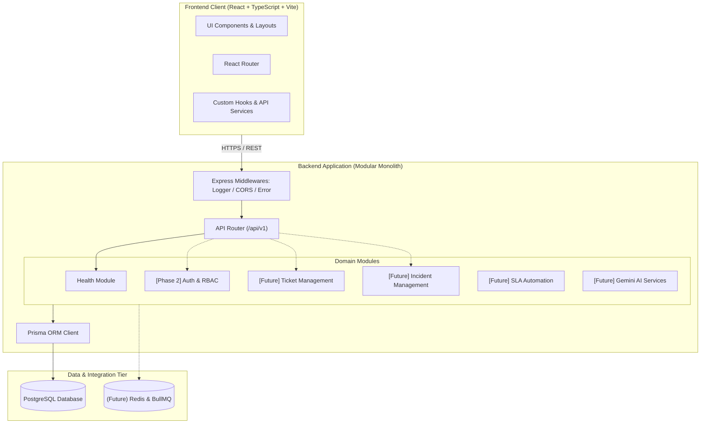

# Aveniq — System Architecture Documentation

## 1. Architectural Philosophy & Strategy

**Aveniq** is architected as an enterprise-grade, multi-tenant Intelligent Incident & Support Management Platform. To balance rapid iteration, type safety, operational simplicity, and long-term scalability, Aveniq adheres to a **Modular Monolith** paradigm.

Rather than prematurely splitting services into distributed microservices—which introduces distributed transaction overhead, network latency, operational fragility, and complex coordination—Aveniq organizes business boundaries into strongly isolated, modular domain modules within a unified codebase and deployment boundary.



---

## 2. Monorepo Organization

The project is structured as a dual-workspace monorepo with clean separation between the frontend client, backend server, and architectural documentation.

```
AVENIQ/
├── client/                     # Frontend client workspace
│   ├── src/
│   │   ├── assets/             # Static graphics, SVGs, and brand assets
│   │   ├── components/         # Reusable presentation and primitive components
│   │   ├── layouts/            # Page layouts and structural containers
│   │   ├── pages/              # Route-level views and screen containers
│   │   ├── routes/             # Client-side router configuration (React Router)
│   │   ├── hooks/              # Custom React hooks encapsulating logic
│   │   ├── services/           # HTTP clients and API consumption layer
│   │   ├── types/              # Client-side TypeScript contracts and interfaces
│   │   └── utils/              # Helper functions, formatters, and classnames
│   ├── .env.example            # Frontend environment variable specification
│   ├── index.html              # Single Page Application HTML entry point
│   ├── package.json            # Client dependencies and build scripts
│   ├── postcss.config.js       # PostCSS processor configuration
│   ├── tailwind.config.js      # Tailwind CSS design system configuration
│   ├── tsconfig.json           # Strict TypeScript client configuration
│   └── vite.config.ts          # Vite bundler, plugin, and alias configuration
├── server/                     # Backend API server workspace
│   ├── prisma/
│   │   └── schema.prisma       # Prisma ORM data modeling & connection schema
│   ├── src/
│   │   ├── config/             # Environment validation, database client, runtime config
│   │   ├── modules/            # Domain-driven feature modules
│   │   │   └── health/         # System health & diagnostic module
│   │   ├── middleware/         # Logging, authentication, error, and 404 middlewares
│   │   ├── common/             # Cross-cutting constants, base types, shared singletons
│   │   ├── utils/              # Structured logger, AppError classes, formatters
│   │   ├── types/              # API contract types and shared interfaces
│   │   ├── app.ts              # Express application factory, routing & middleware pipeline
│   │   └── server.ts           # HTTP server bootstrapping and graceful shutdown handlers
│   ├── tests/                  # Backend test suites (unit, integration, e2e)
│   ├── .env.example            # Backend environment variable template
│   ├── package.json            # Server dependencies and lifecycle scripts
│   └── tsconfig.json           # Strict TypeScript server configuration
├── docs/                       # Architectural specifications and ADRs
│   └── ARCHITECTURE.md         # Comprehensive system architecture document
├── .gitignore                  # Git exclusions for dependencies, builds, and secrets
├── .prettierrc                 # Unified code formatting configuration
├── package.json                # Root workspace configuration and unified scripts
└── README.md                   # Primary project overview and getting started guide
```

---

## 3. Frontend Architecture

### 3.1 Technology Foundation

- **React 18 & TypeScript**: Functional components, typed hooks, strict mode compilation (`noImplicitAny`, `strictNullChecks`).
- **Vite**: Lightning-fast Hot Module Replacement (HMR) and optimized Rollup production builds.
- **Tailwind CSS**: Utility-first styling with consistent design tokens for colors, typography, borders, and dark mode.
- **React Router v7**: Declarative client-side routing supporting nested routes, layout wrappers, and code splitting.
- **Lucide React**: Clean, accessible iconography.

### 3.2 Design Principles

1. **Component Hierarchy**: Presentation components (`components/`) are kept stateless or locally scoped. Layout wrappers (`layouts/`) define structural frames (navigation, breadcrumbs, footers). Page views (`pages/`) bind routing parameters and trigger data-fetching hooks.
2. **API Isolation**: Components never perform raw `fetch` calls directly. All backend communication is abstracted into service modules (`services/`) which return strongly-typed data contracts (`types/`).
3. **Data Hooks**: Custom hooks (`hooks/`) manage async request states (loading, error, data, refetch) to eliminate boilerplate in view components.

---

## 4. Backend Architecture

### 4.1 Technology Foundation

- **Node.js (LTS v22+) & TypeScript**: Pure ES Modules (`"type": "module"`) running on strict modern JavaScript standards.
- **Express.js**: Proven, minimalistic HTTP routing engine.
- **Zod**: Strict, declarative schema validation for environment variables and future API payloads.
- **Prisma ORM**: Type-safe database queries, schema migrations, and connection management for PostgreSQL.
- **TSX**: Zero-overhead TypeScript execution and watch mode for development.

### 4.2 Request Pipeline

Every HTTP request follows a deterministic pipeline through Express:

```
Incoming Request
      │
      ▼
┌────────────────────────┐
│   CORS Configuration   │  Validates origin headers against configured whitelist
└───────────┬────────────┘
      │
      ▼
┌────────────────────────┐
│ Body Parsers (JSON/URL)│  Parses incoming JSON payloads with size constraints
└───────────┬────────────┘
      │
      ▼
┌────────────────────────┐
│ Request Logger         │  Logs method, URL, client IP, response time, and status code
└───────────┬────────────┘
      │
      ▼
┌────────────────────────┐
│ API Router (/api/v1)   │  Routes requests to modular domain endpoints
└───────────┬────────────┘
      │
      ├───► [Health Module]      GET /api/v1/health
      ├───► [Future Modules]     /auth, /tickets, /incidents
      │
      ▼
┌────────────────────────┐
│ 404 Not Found Handler  │  Catches unmatched paths and yields structured AppError
└───────────┬────────────┘
      │
      ▼
┌────────────────────────┐
│ Central Error Handler  │  Serializes AppErrors, ZodErrors, and 500s into unified JSON
└────────────────────────┘
```

### 4.3 Centralized Error Handling & Logging

The system defines an explicit error taxonomy using `AppError`:

- **Operational Errors**: Predictable exceptions (e.g., validation failure, unauthorized access, resource missing) retain custom HTTP status codes and machine-readable error codes.
- **System / Unhandled Errors**: Unexpected exceptions are logged with full stack traces on the server, while the client receives a sanitized `500 INTERNAL_SERVER_ERROR` payload to prevent leaking internal stack traces in production.

All API responses follow a uniform contract envelope:

```typescript
// Standard API Envelope
export interface ApiResponse<T = unknown> {
  status: 'success' | 'error';
  message?: string;
  data?: T;
  error?: {
    code: string;
    message: string;
    details?: unknown;
  };
}
```

---

## 5. Database Integration & Prisma ORM

### 5.1 Architecture & Connection Lifecycle

- **PostgreSQL**: Selected for multi-tenant ACID compliance, JSONB document querying capabilities, robust indexing, and row-level security capabilities.
- **Prisma Client**: Provides type-safe client generation derived from `server/prisma/schema.prisma`.
- **Connection Management**: A single connection pool is instantiated on startup (`globalThis.__aveniq_prisma__`) and cleanly closed via process signal handlers (`SIGINT`, `SIGTERM`).
- **Resilience**: The database connection check runs a non-destructive ping query (`SELECT 1`). If PostgreSQL is provisioned and reachable, the status reports `connected`; if pending or offline, the server starts safely without crashing, returning `pending_configuration`.

---

## 6. Modular Monolith Design & Future Roadmap

To ensure scalability without early microservice complexity, the backend follows domain boundaries within `server/src/modules/`:

| Module                       | Planned Phase           | Primary Capabilities                                                                           |
| :--------------------------- | :---------------------- | :--------------------------------------------------------------------------------------------- |
| **Health**                   | **Phase 1 (Completed)** | System diagnostics, uptime, and database connection probe                                      |
| **Auth & RBAC**              | Phase 2                 | JWT / Session auth, password hashing, multi-tenant roles (Admin, Manager, Agent, Requester)    |
| **Ticket Management**        | Phase 3                 | Ticket lifecycle (Open, Pending, Resolved, Closed), prioritization, assignment                 |
| **Incident Management**      | Phase 4                 | Service disruption tracking, root cause analysis, incident impact severity                     |
| **SLA Automation**           | Phase 5                 | Response and resolution deadline trackers, escalation policies, background timers              |
| **Real-Time Communication**  | Phase 6                 | Socket.IO real-time agent updates, live activity feeds, typing indicators                      |
| **AI Assistant & Analytics** | Phase 7                 | Google Gemini API integration for automated ticket categorization, reply drafting, and summary |
| **API Documentation**        | Phase 8                 | OpenAPI / Swagger interactive documentation and developer portals                              |

Each module maintains encapsulated routes, controllers, services, and DTO schemas, preventing tight coupling across domains while sharing common database infrastructure.
